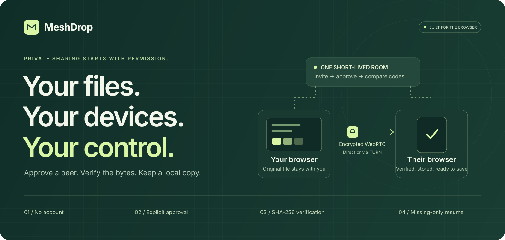
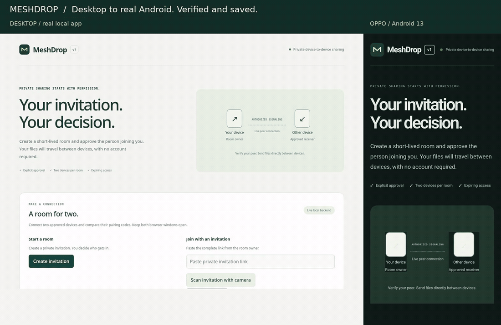
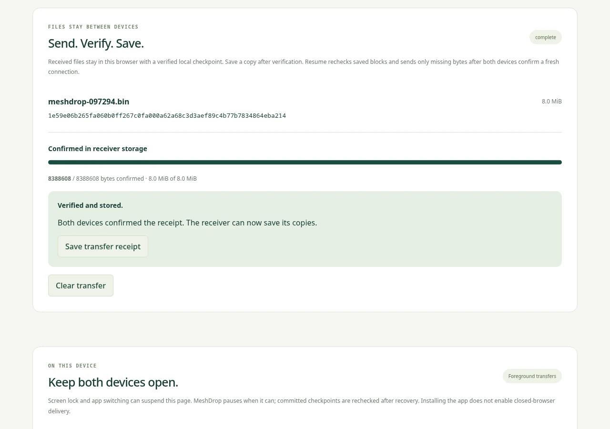
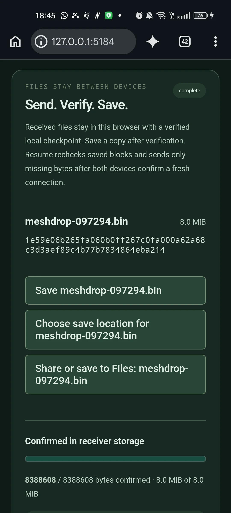
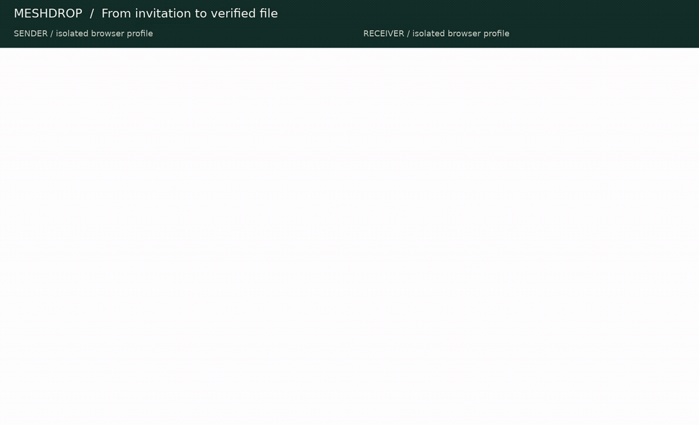
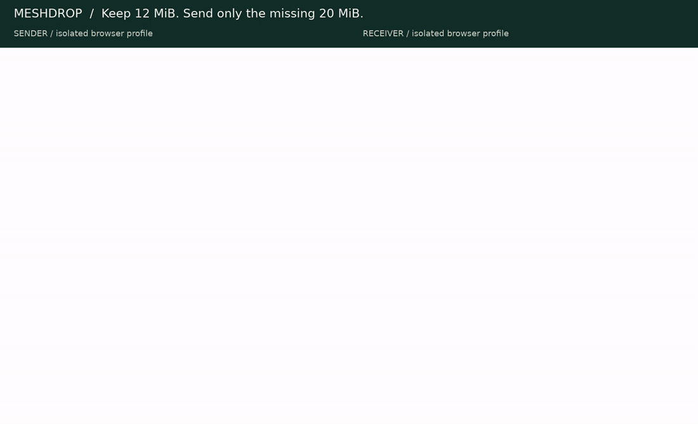
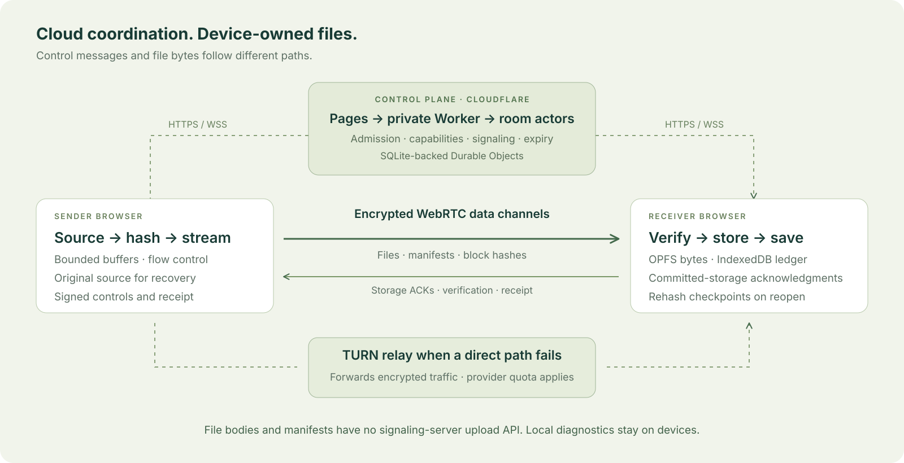

<div align="center">

<a href="https://meshdrop-7ce2dc2e-production.pages.dev"></a>

# MeshDrop

### A room for two. A file you can verify.

Account-free file sharing between browsers, with explicit approval, verified local storage, and authenticated resume.

[](https://github.com/Shreshtha280407/MeshDrop/actions/workflows/ci.yml)


[](LICENSE)

**[Open MeshDrop ↗](https://meshdrop-7ce2dc2e-production.pages.dev)** · **[Public preview ↗](https://meshdrop-8ab9cb08-preview.pages.dev)**

[See it in action](#see-it-in-action) · [Try it locally](#try-it-locally) · [How it works](#how-it-works) · [Architecture](#architecture) · [Verification](#verification-and-evidence) · [Support](#browser-support-and-limits)

</div>

---

## Your files should arrive intact

Moving a file between devices should give you a clear answer to three questions: who is receiving it, which bytes have arrived, and what happens if the connection breaks?

MeshDrop starts with a private, expiring invitation. The sender approves one receiver, both sides compare a pairing code, and file delivery begins only after confirmation. Progress advances when verified blocks reach the receiver's browser storage. Completion requires a final file hash and a confirmed transfer receipt.

Cloudflare coordinates the room. File bytes travel over encrypted WebRTC, directly when possible or through a configured TURN relay. The receiving device owns its temporary files, checkpoints, and saved exports. There is no compulsory account or central file library.

| Before sharing                                                                      | During delivery                                                                              | After an interruption                                                                  |
| ----------------------------------------------------------------------------------- | -------------------------------------------------------------------------------------------- | -------------------------------------------------------------------------------------- |
| Approve the intended receiver and compare codes through a separate trusted channel. | Follow receiver-confirmed progress, pause or cancel, and save the verified file and receipt. | Recheck surviving blocks, confirm a fresh connection, and send only the missing bytes. |

## See it in action

### Real Android phone + desktop workspace

<a href="docs/assets/readme/android-transfer.mp4"><picture><source media="(prefers-reduced-motion: reduce)" srcset="docs/assets/readme/android-desktop.webp"></picture></a>

<p align="center"><sub>Captured on a physical OPPO F19 Pro / Android 13 and a fresh desktop browser. An 8 MiB synthetic file was downloaded on the phone, retrieved over ADB, and independently SHA-256 checked. The local app used an ADB reverse tunnel; this recording does not establish public-network performance. <a href="docs/assets/readme/android-transfer.mp4">Watch the full recording ↗</a></sub></p>

<details>
<summary><b>Inspect the desktop and phone screenshots</b></summary>

<table>
<tr>
<td width="72%" valign="top" align="center">
<b>Desktop workspace</b><br><br>

</td>
<td width="28%" valign="top" align="center">
<b>Physical Android phone</b><br><br>

</td>
</tr>
</table>

[Phone home](docs/assets/readme/android-home.webp) · [Phone pairing](docs/assets/readme/android-pairing.webp) · [Phone insights](docs/assets/readme/android-insights.webp) · [Desktop insights](docs/assets/readme/desktop-insights.webp)

</details>

<details>
<summary><b>Desktop browser-to-browser walkthrough</b></summary>

<a href="docs/assets/readme/browser-transfer.mp4"><picture><source media="(prefers-reduced-motion: reduce)" srcset="docs/assets/readme/verified.webp"></picture></a>

Recorded against the real local Worker, SQLite room actors, WebSockets, and WebRTC. The exported **16 MiB** file matched its source SHA-256; receipt and diagnostics checks passed with **zero JavaScript page errors**. [Watch the recording](docs/assets/readme/browser-transfer.mp4).

</details>

## Try it locally

Use **Node 24 LTS** and **pnpm 10.34.7**. The supported Node range is `>=22.12.0 <27`. Install pnpm with `npm install --global pnpm@10.34.7` if needed.

```bash
git clone https://github.com/Shreshtha280407/MeshDrop.git
cd MeshDrop
pnpm install --frozen-lockfile
pnpm dev
```

| Service          | Local address                                         |
| ---------------- | ----------------------------------------------------- |
| Web app          | [127.0.0.1:5173](http://127.0.0.1:5173)               |
| Signaling health | [127.0.0.1:8787/health](http://127.0.0.1:8787/health) |

Open the app in **two independent regular browser profiles**. Create an invitation in the first, paste it into the second, request admission, and approve the receiver. Compare the codes, confirm on both sides, offer a file, and accept it on the receiver. Wait for **Verified and stored**, then save the file and receipt.

Local direct transfers need no cloud login, provider key, or `.env`. Development servers bind to loopback. For another physical device, use the deployed HTTPS app or the [authorized Android setup](docs/runbooks/mobile-pwa.md); an arbitrary HTTP LAN address does not provide the required secure browser context.

<details>
<summary><b>Configuration and deployment</b></summary>

For local overrides, copy `apps/signaling/.env.example` to an ignored `.env` beside the Wrangler configuration. Keep provider and operator secrets server-side; never place them in frontend `VITE_*` variables or tracked source. Leave optional TURN settings unset for direct-only local development.

Preview and production use separate Cloudflare Pages projects, private signaling Workers, room namespaces, and operator proofs. They share provider-account quotas. Deployment tooling prepares frozen bundles and hashes before publication; builds and Worker dry runs do not deploy anything.

The hosted Metered Free relay uses a **shared 0.5 GB monthly hard stop**. Exhausted quota or unavailable credentials can leave only direct connectivity. There is no unlimited-relay claim.

[Deployment guide](docs/deploy.md) · [Operations runbook](docs/runbook.md) · [Relay configuration and policy](infrastructure/turn/README.md) · [Secret handling](docs/security/secrets.md)

</details>

## How it works

1. **Invite one receiver.** Create a short-lived room and privately share its link or optional QR. The sender decides who enters; a third device cannot join the approved pair.
2. **Compare independently.** Read the pairing code aloud or compare both screens in person. Both devices confirm before file offers are enabled.
3. **Offer and accept.** The sender chooses files. The receiver reviews the offer, available storage, export limits, and checkpoint-retention policy.
4. **Stream and verify.** Worker-based SHA-256, bounded queues, and flow control keep the pipeline moving. A block acknowledgment follows receiver storage commitment; final verification precedes completion.
5. **Save a copy.** Download the verified file and receipt. Clear the temporary transfer when the saved copy is safe.

### Progress that means something

| What can go wrong                                  | MeshDrop's control                                                                                             |
| -------------------------------------------------- | -------------------------------------------------------------------------------------------------------------- |
| Someone obtains the invitation                     | Explicit sender approval, one receiver, expiring access, and independent pairing-code comparison.              |
| Network buffers fill while the UI appears finished | Bounded send queues and progress based on receiver-confirmed storage.                                          |
| A block or final file does not match               | Hash verification prevents that data from becoming verified completion.                                        |
| The browser closes during delivery                 | OPFS bytes and an IndexedDB checkpoint ledger can retain progress; surviving blocks are reread and rehashed.   |
| A resumed source file has changed                  | Exact-source validation, renewed authorization, fresh pairing, and authenticated missing-range reconciliation. |
| A phone hides the page or runs out of storage      | Foreground lifecycle handling, quota checks, explicit pause/recovery, and no false storage acknowledgment.     |
| A slow transfer invites guesswork                  | Local measurements identify rates, buffer pressure, RTT, observed connection path, and unavailable fields.     |

### Resume the missing bytes

<a href="docs/assets/readme/browser-recovery.mp4"><picture><source media="(prefers-reduced-motion: reduce)" srcset="docs/assets/readme/recovery.webp"></picture></a>

The recording pauses a **32 MiB** transfer after **12 MiB**, explicitly restarts ICE, advances the connection epoch, and repeats code comparison. The sender prepares the original source; the receiver resumes its verified checkpoint. Exactly **20 MiB** is sent on the new attempt, and the saved file matches the original SHA-256.

This is a controlled local connection restart. Separate [physical production evidence](docs/reports/evidence/phase-9-android-production-relay.json) records a real Android Wi-Fi outage and recovery.

If a tab was closed, reopen the same origin and browser profile, establish new room admission, and inspect **Saved transfers**. Recovery depends on surviving storage and the exact original file; old in-memory room credentials are not restored. [Recovery guide](docs/runbooks/resume.md).

## Architecture



The control plane authorizes and connects two peers. The data plane streams, verifies, stores, and recovers file bytes on the devices. File bodies and manifests have no signaling-server upload API. A TURN relay forwards encrypted WebRTC traffic when available; it is a transport dependency with its own metadata and quota boundaries.

| Layer                 | Technology                                  | Responsibility                                                                                      |
| --------------------- | ------------------------------------------- | --------------------------------------------------------------------------------------------------- |
| Web app               | React, Vite, strict TypeScript              | Invitations, approval, pairing, file offers, saved transfers, diagnostics, and responsive controls. |
| Control plane         | Cloudflare Pages gateway, private Worker    | Same-origin HTTPS/WSS, validated routes, capability admission, origin/rate/TTL policy.              |
| Room state            | SQLite-backed Durable Objects               | Two-peer membership, approval, replay protection, revocation, and expiry.                           |
| Peer transport        | Native WebRTC and signed controls           | ICE negotiation, independently compared pairing, connection epochs, and encrypted data channels.    |
| Transfer engine       | Web Workers, incremental SHA-256            | Streaming, bounded buffers, flow control, committed-storage ACKs, final verification, and receipts. |
| Local recovery        | OPFS, IndexedDB                             | File bytes, checkpoint ledger, reconciliation, rehashing, retention, and missing-only resume.       |
| Platform and insights | Capability probes, PWA shell, local metrics | Storage policy, foreground handling, save/share adapters, rates, history, and JSON/CSV exports.     |
| Verification          | Vitest, Playwright, workerd                 | Unit, security/property, real Worker integration, fault, browser, and production PWA checks.        |

Protocol and shared-type packages stay independent of React, Node, and Cloudflare APIs; ESLint enforces the import boundary. [Architecture decisions](docs/adr/001-control-data-planes.md) · [Protocol v1](docs/protocol/v1.md).

## Verification and evidence

The [GitHub CI workflow](.github/workflows/ci.yml) gates frozen installation, package/root types, lint/formatting, secret scanning, dependency audit, security, unit, integration, fault tests, builds, browser flows, and production PWA checks. The badge above links to its current status.

The **25–26 October 2026** full verification recorded **642 distinct passing tests**. These are dated results, separate from the fresh README captures:

| Suite          | Recorded passing cases | What it exercises                                                                                               |
| -------------- | ---------------------- | --------------------------------------------------------------------------------------------------------------- |
| Unit           | 406                    | Contracts, states, transfer/storage/recovery logic, platform policy, provider adapters, and deployment tooling. |
| Security       | 42                     | Bounded input and queues, deterministic fuzzing, range properties, and abuse rejection.                         |
| Integration    | 65                     | Actual local workerd, SQLite actors, HTTP/WebSockets, authorization, hibernation, expiry, and operations.       |
| Fault          | 18                     | Lifecycle transitions and recovery/reconciliation faults.                                                       |
| Browser        | 106                    | Admission, pairing, real transfer/export, storage, recovery, cross-engine checks, and mobile emulation.         |
| Production PWA | 5                      | Built shell, CSP/privacy, offline export, and explicit updates.                                                 |

The README's **4 November 2026** captures separately verify 16 MiB delivery, 32 MiB authenticated recovery, and a physical Android 8 MiB native download. Exported bytes and receipts match their sources. [Capture manifest](docs/assets/readme/capture-manifest.json) · [Media scope and provenance](docs/assets/readme/MEDIA.md).

```bash
# Install the browser engines once; Linux CI also uses --with-deps.
pnpm exec playwright install chromium firefox webkit

# Automated application gates; no cloud publication.
pnpm check

# Current registry advisory check; requires network access.
pnpm audit:release
```

<details>
<summary><b>Focused checks and larger-file measurements</b></summary>

```bash
pnpm test:unit
pnpm test:security
pnpm test:integration
pnpm test:faults
pnpm test:e2e
pnpm test:pwa

# Benchmarks require their documented browser, storage, and network setup.
pnpm bench:p3  # 100 MiB / 1 GiB streaming, export hashes, measured memory
pnpm bench:p4  # 300+ MiB receive, close/reopen, and checkpoint rehash
pnpm bench:p5  # 1 GiB interrupted transfer and isolated subnet-change resume
pnpm bench:p9  # 100 MiB / 1 GiB / 2 GiB normal and disconnect matrix
```

`pnpm build` produces web assets and a Worker dry run; it does not publish. Large-file benchmarks need several GiB of free disk and are separate from everyday test runs. Use the [local-development guide](docs/runbooks/local-development.md), [streaming runbook](docs/runbooks/streaming-verification.md), and [resume runbook](docs/runbooks/resume.md) for exact prerequisites.

</details>

Hosted preview and production evidence covers real UDP/TCP/TLS relay delivery, environment isolation, authenticated HTTPS alerts, and compatible paired Pages/Worker rollback. Local 100 MiB / 1 GiB / 2 GiB benchmarks and smaller physical-device runs retain their own measured scopes. [Latest implementation audit](docs/reports/continuation-2026-10-25.md) · [Hosted release evidence](docs/reports/evidence/phase-9-hosted-release.json).

## Browser support and limits

| Platform                           | Evidence recorded                                                                        | Boundary                                                                                |
| ---------------------------------- | ---------------------------------------------------------------------------------------- | --------------------------------------------------------------------------------------- |
| Linux Chromium                     | Automated transfer/recovery/export, local large-file matrix, PWA/privacy checks.         | Large local tests do not certify public or mobile throughput.                           |
| Linux Firefox and WebKit           | Real cross-engine pairing, file delivery, and matching exports.                          | Engine coverage does not certify every native OS workflow.                              |
| Physical OPPO Android 13           | Direct and relay delivery, native downloads, recovery; a new local 8 MiB README capture. | PWA installation, optical QR, every network, and universal file sizes remain unclaimed. |
| Real cloud iPhone / Safari         | Dated direct/relay receive, saved-file verification, and selected recovery cases.        | Further native picker/share/install and full OS lifecycle work are deferred.            |
| iPad, Windows Chrome, macOS Safari | Dated small-file receiving/export checks.                                                | Reverse roles, recovery, and larger-file coverage vary and remain incomplete.           |

Both devices need network access and MeshDrop open during delivery. Screen lock, app switching, exhausted relay quota, browser eviction, or cleared site data can interrupt availability or remove checkpoints. Installing the PWA does not enable background or closed-browser transfer. With unknown quota, this app permits at most **64 MiB** per new offer; offers from **300 MiB** require an additional warning acknowledgment. Export can need extra disk space.

[Measured support matrix](docs/support-matrix.md) · [Device/browser matrix](tests/devices/browser-matrix.md) · [User guide](docs/user-guide.md).

## Privacy and trust boundaries

- **Approval and comparison have different jobs.** Approval admits a device; an independently compared code binds the connection transcript. Neither establishes a person's legal identity or repairs a compromised browser.
- **Transport is encrypted; metadata still exists.** Cloudflare, STUN/TURN providers, and peers can process network addressing and timing. MeshDrop does not provide network anonymity.
- **Browser files are local, not a backup.** OPFS and IndexedDB are subject to profile access, quota, eviction, site-data clearing, and the selected retention policy. OPFS is not an application-encrypted vault.
- **Diagnostics are optional and local.** No automatic diagnostics upload, third-party analytics, or remote QR scanner is included. Review exported reports before sharing them.
- **A receipt describes the application transfer.** It is not a legal delivery guarantee, permanent-storage promise, or proof that a malicious receiver retained a copy. Saved files can be redistributed by their recipient.

[Privacy notice](docs/privacy-notice.md) · [Threat model](docs/threat-model.md) · [Security review](docs/security-review.md).

## Implementation status

Implementation is present through **P0–P9**. Full acceptance remains bounded by the documented platform and operational coverage.

| Phases | Delivered                                                                                                                              |
| ------ | -------------------------------------------------------------------------------------------------------------------------------------- |
| P0–P1  | Strict workspace/contracts, state machines, CI, SQLite rooms, admission, capabilities, origin/rate/TTL checks, and revocation.         |
| P2–P3  | Authenticated pairing, ICE/temporary relay credentials, streaming, bounded buffers, SHA-256, storage ACKs, pause/cancel, and receipts. |
| P4–P5  | Local checkpoints, quota/retention, reopen/rehash, exact-source validation, fresh epochs, and missing-only authenticated resume.       |
| P6–P7  | Measured diagnostics and exports, capability/lifecycle policy, mobile controls, save/share adapters, and production PWA shell.         |
| P8–P9  | Security/abuse hardening, isolated hosting, managed free relay, monitoring/alerts, compatible rollback, benchmarks, and runbooks.      |

Remaining acceptance includes broader physical platform/lifecycle coverage, native export/install variants, optical QR, and larger public/mobile transfer measurements. The GitHub manual deployment path also needs its environment and branch protections configured. Post-MVP ideas are outside the supplied P0–P9 plan. [Detailed phase status](docs/reports/continuation-2026-10-25.md).

## Find your way around

```text
apps/web/                      React/Vite browser interface and PWA
apps/signaling/                Worker routes and SQLite room/relay/monitor actors
packages/protocol/             Strict schemas, frames, and state machines
packages/shared-types/         Shared API and device interfaces
packages/peer-connection/      WebRTC, ICE, pairing, and signed controls
packages/transfer-core/        Streaming, hashing, flow control, and receipts
packages/storage/              OPFS bytes, IndexedDB checkpoints, and exports
packages/recovery/             Epochs, source identity, ranges, and reconciliation
packages/network-intelligence/ Measured rates, history, and report exports
packages/platform/             Capability probes, storage policy, and lifecycle
tests/                         Unit, security, integration, fault, browser, PWA
scripts/                       Local verification, deployment, and benchmarks
infrastructure/                Cloudflare and optional TURN configuration
docs/                          Contracts, decisions, runbooks, and reviewed evidence
```

| Start here              | Read                                                                                                                                                             |
| ----------------------- | ---------------------------------------------------------------------------------------------------------------------------------------------------------------- |
| Use the app             | [User guide](docs/user-guide.md) · [Support matrix](docs/support-matrix.md)                                                                                      |
| Build and debug         | [Local development](docs/runbooks/local-development.md) · [Peer connectivity](docs/runbooks/peer-connectivity.md)                                                |
| Understand the protocol | [Protocol v1](docs/protocol/v1.md) · [State machines](docs/protocol/states.md) · [Transfer](docs/protocol/transfer-p3.md) · [Resume](docs/protocol/resume-p5.md) |
| Deploy and operate      | [Deployment](docs/deploy.md) · [Operations](docs/runbook.md) · [Relay policy](infrastructure/turn/README.md)                                                     |
| Review the evidence     | [Latest audit](docs/reports/continuation-2026-10-25.md) · [Release report](docs/reports/phase-9.md) · [README captures](docs/assets/readme/MEDIA.md)             |

<div align="center">

<br>

**MeshDrop · Invite. Compare. Send. Verify. Save.**

[Open MeshDrop ↗](https://meshdrop-7ce2dc2e-production.pages.dev) · [MIT license](LICENSE)

</div>
