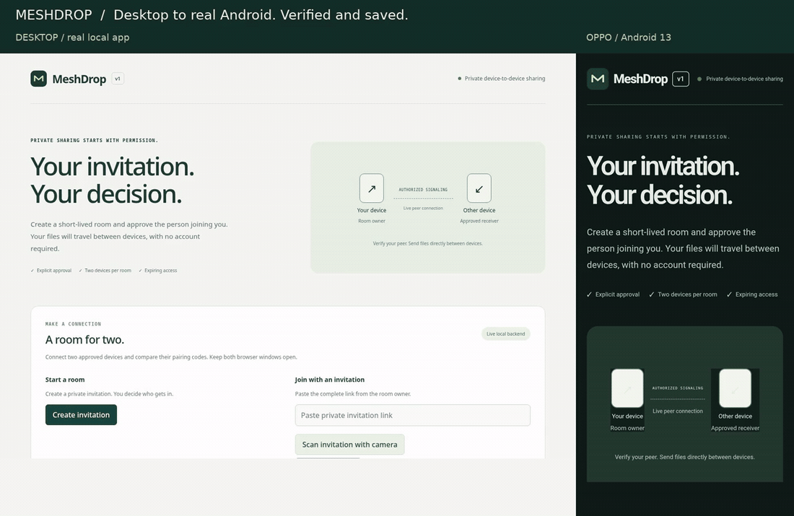
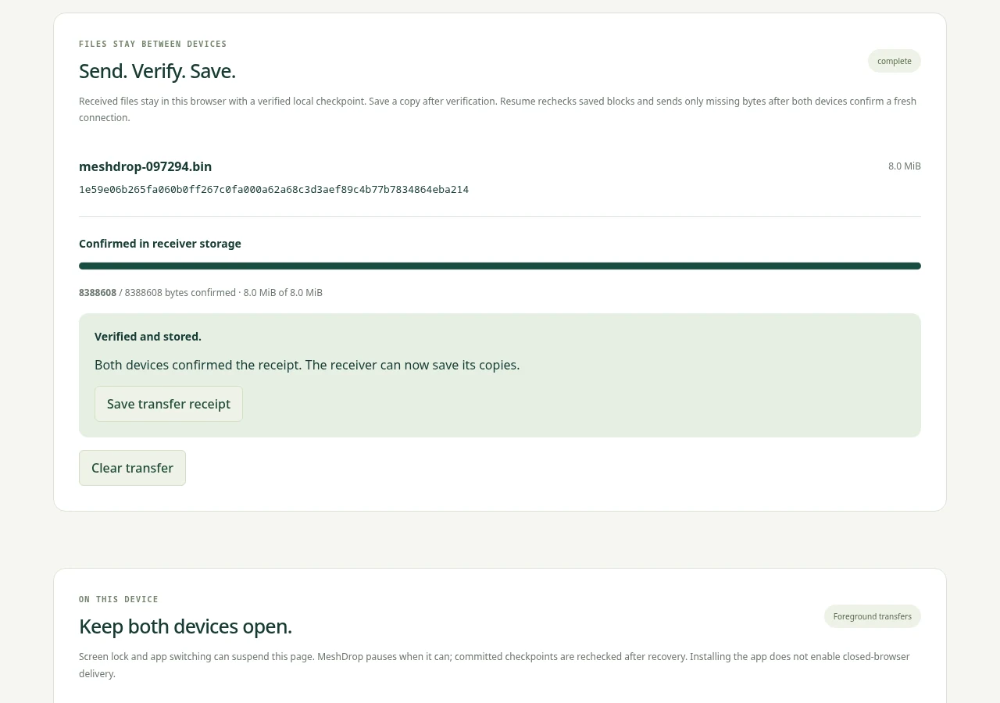
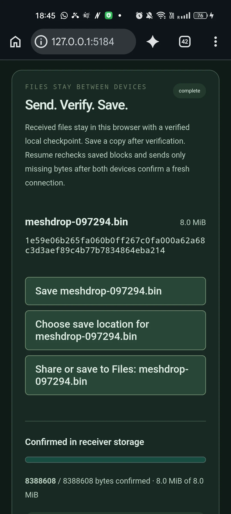
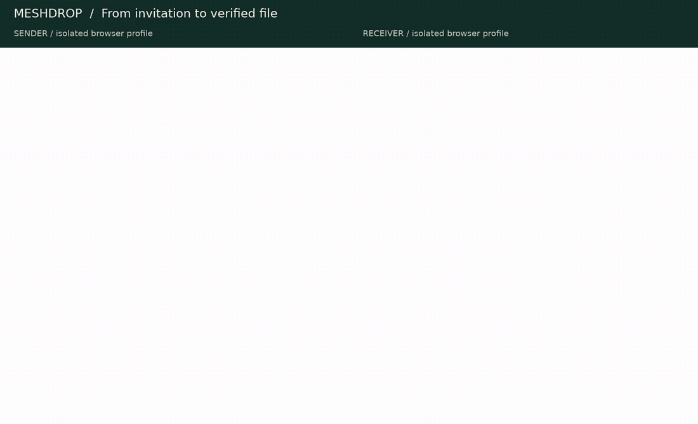
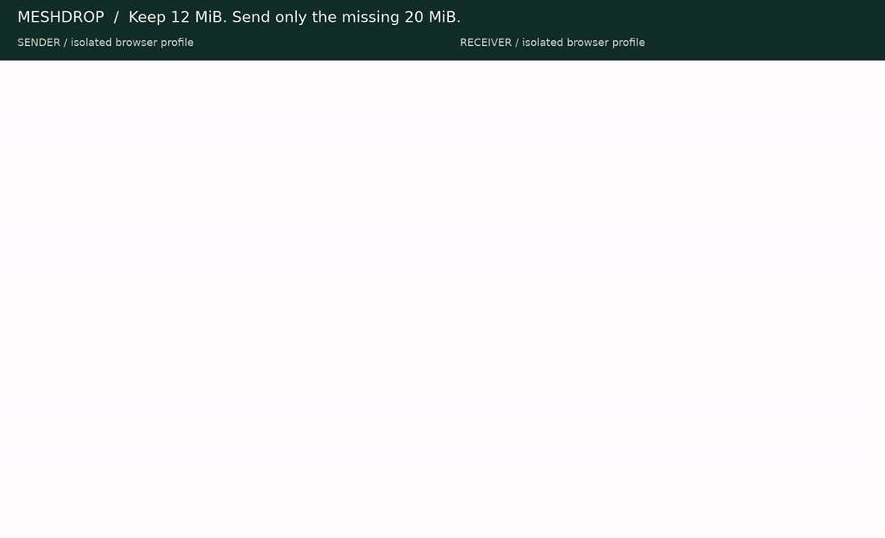
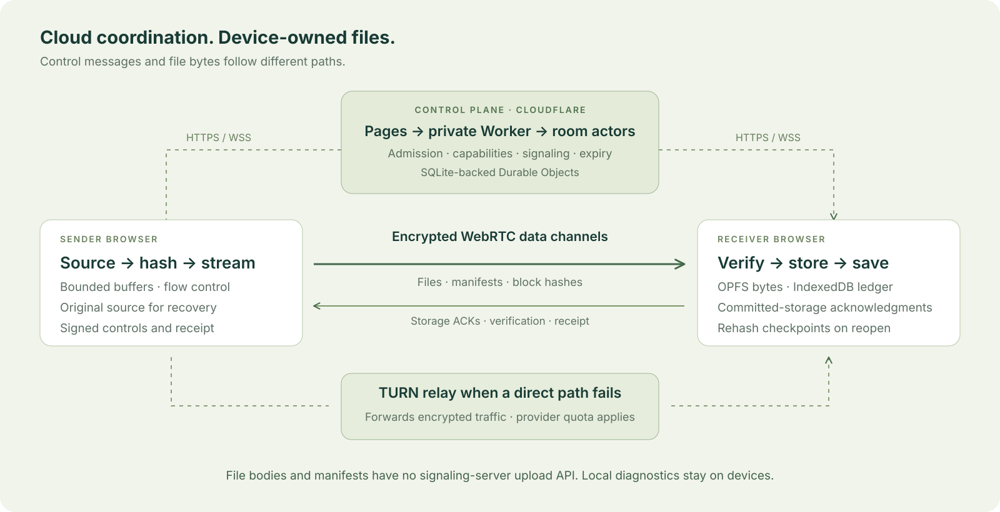

# MeshDrop

**[Watch Demo Video](docs/assets/readme/demo-video.mp4)**

Laptop → physical OPPO · OPPO → laptop · two profiles on one laptop · OPPO → emulated mobile browser. Recorded locally with parallel sender/receiver views and independently hashed exports; [media scope and source revisions](docs/assets/readme/MEDIA.md).

**A room for two. A file you can verify.**

MeshDrop delivers files between browsers without accounts or a central file-upload/storage service. The sender approves one receiver, both devices independently compare a pairing code, and progress counts receiver-committed bytes. Files travel over encrypted WebRTC, directly or through a configured TURN relay.

[](https://github.com/Shreshtha280407/MeshDrop/actions/workflows/ci.yml)
[](LICENSE)

[Current status](docs/CURRENT_STATUS.md) · [Run locally](#run-locally) · [Architecture](#architecture) · [Verification](#current-build-verification) · [Support](#support-and-limits) · [Security](#security-and-privacy)

## Engineering highlights

- **Explicit trust:** short-lived bearer invitations, owner approval, independently compared connection codes, two-peer membership and epoch/replay checks.
- **Verifiable delivery:** incremental SHA-256, bounded queues, storage commitment before ACK, final hashes and scoped transfer receipts. Completion and external export are separate results.
- **Recoverable transfers:** OPFS bytes and an IndexedDB ledger, restart rehash, exact-source checks, fresh admission/pairing and missing-only resume.
- **Measured hardening:** 1,816 distinct automated full-check cases at the final roadmap acceptance source; 1 GiB logical streaming simulation and real 64 MiB browser transfers; 100 local logical paired rooms with 200 real local signaling sockets. These are separate scopes, not hosted capacity claims.
- **Usable interfaces:** keyboard workflows, bounded announcements, reduced motion, responsive layouts and 99 automated accessibility scans with zero reported violations in the final Task 17 check. No formal accessibility certification is claimed.


## See it in action

### Real Android phone + desktop workspace

<a href="docs/assets/readme/android-transfer.mp4"><picture><source media="(prefers-reduced-motion: reduce)" srcset="docs/assets/readme/android-desktop.webp"></picture></a>

<p align="center"><sub>Captured on a physical OPPO F19 Pro / Android 13 and a fresh desktop browser. An 8 MiB synthetic file was downloaded on the phone, retrieved over ADB, and independently SHA-256 checked. The local app used an ADB reverse tunnel; this recording does not establish public-network performance. <a href="docs/assets/readme/android-transfer.mp4">Watch the full recording ↗</a></sub></p>

<details>
<summary><b>Inspect the desktop and phone screenshots</b></summary>

<table>
<tr>
<td width="72%" valign="top" align="center">
<b>Desktop workspace</b><br><br>

</td>
<td width="28%" valign="top" align="center">
<b>Physical Android phone</b><br><br>

</td>
</tr>
</table>

[Phone home](docs/assets/readme/android-home.webp) · [Phone pairing](docs/assets/readme/android-pairing.webp) · [Phone insights](docs/assets/readme/android-insights.webp) · [Desktop insights](docs/assets/readme/desktop-insights.webp)

</details>

<details>
<summary><b>Desktop browser-to-browser walkthrough</b></summary>

<a href="docs/assets/readme/browser-transfer.mp4"><picture><source media="(prefers-reduced-motion: reduce)" srcset="docs/assets/readme/verified.webp"></picture></a>

Recorded against the real local Worker, SQLite room actors, WebSockets, and WebRTC. The exported **16 MiB** file matched its source SHA-256; receipt and diagnostics checks passed with **zero JavaScript page errors**. [Watch the recording](docs/assets/readme/browser-transfer.mp4).

</details>

## Try it locally

Use **Node 24 LTS** and **pnpm 10.34.7**. The supported Node range is `>=22.12.0 <27`. Install pnpm with `npm install --global pnpm@10.34.7` if needed.

```bash
git clone https://github.com/Shreshtha280407/MeshDrop.git
cd MeshDrop
pnpm install --frozen-lockfile
pnpm dev
```

| Service          | Local address                                         |
| ---------------- | ----------------------------------------------------- |
| Web app          | [127.0.0.1:5173](http://127.0.0.1:5173)               |
| Signaling health | [127.0.0.1:8787/health](http://127.0.0.1:8787/health) |

Open the app in **two independent regular browser profiles**. Create an invitation in the first, paste it into the second, request admission, and approve the receiver. Compare the codes, confirm on both sides, offer a file, and accept it on the receiver. Wait for **Verified and stored**, then save the file and receipt.

Local direct transfers need no cloud login, provider key, or `.env`. Development servers bind to loopback. For another physical device, use the deployed HTTPS app or the [authorized Android setup](docs/runbooks/mobile-pwa.md); an arbitrary HTTP LAN address does not provide the required secure browser context.

<details>
<summary><b>Configuration and deployment</b></summary>

For local overrides, copy `apps/signaling/.env.example` to an ignored `.env` beside the Wrangler configuration. Keep provider and operator secrets server-side; never place them in frontend `VITE_*` variables or tracked source. Leave optional TURN settings unset for direct-only local development.

Preview and production use separate Cloudflare Pages projects, private signaling Workers, room namespaces, and operator proofs. They share provider-account quotas. Deployment tooling prepares frozen bundles and hashes before publication; builds and Worker dry runs do not deploy anything.

The hosted Metered Free relay uses a **shared 0.5 GB monthly hard stop**. Exhausted quota or unavailable credentials can leave only direct connectivity. There is no unlimited-relay claim.

[Deployment guide](docs/deploy.md) · [Operations runbook](docs/runbook.md) · [Relay configuration and policy](infrastructure/turn/README.md) · [Secret handling](docs/security/secrets.md)

</details>

### Resume the missing bytes

<a href="docs/assets/readme/browser-recovery.mp4"><picture><source media="(prefers-reduced-motion: reduce)" srcset="docs/assets/readme/recovery.webp"></picture></a>

The recording pauses a **32 MiB** transfer after **12 MiB**, explicitly restarts ICE, advances the connection epoch, and repeats code comparison. The sender prepares the original source; the receiver resumes its verified checkpoint. Exactly **20 MiB** is sent on the new attempt, and the saved file matches the original SHA-256.

This is a controlled local connection restart. Separate [physical production evidence](docs/reports/evidence/phase-9-android-production-relay.json) records a real Android Wi-Fi outage and recovery.

If a tab was closed, reopen the same origin and browser profile, establish new room admission, and inspect **Saved transfers**. Recovery depends on surviving storage and the exact original file; old in-memory room credentials are not restored. [Recovery guide](docs/runbooks/resume.md).

## Architecture



| Layer                          | Responsibility                                                                                                                  |
| ------------------------------ | ------------------------------------------------------------------------------------------------------------------------------- |
| React/Vite UI                  | Invitation, approval, pairing, transfer/export, recovery, device capabilities and accessible controls                           |
| Pages gateway + private Worker | Same-origin HTTPS/WSS, admission, origin/rate/TTL policy and bounded SDP/ICE forwarding                                         |
| SQLite Durable Objects         | `SessionRoom` membership/replay state; `RelayPool` credential/quota coordination; `OperationsMonitor` bounded operations/alerts |
| WebRTC + optional TURN         | Encrypted peer data channels; TURN forwards encrypted packets when used, with provider metadata/quota limits                    |
| Transfer/storage workers       | Streaming SHA-256, bounded buffers, verified block writes, final hashes and receipt handshake                                   |
| OPFS + IndexedDB               | Temporary received bytes, checkpoint ledger, scoped retention/deletion and rehash before recovery                               |
| Local diagnostics + PWA        | Opt-in bounded measurements/exports and public offline shell; no background file delivery                                       |

The control plane has no file-body or manifest upload API. The data plane carries files, manifests, ACKs and receipts between peers. TURN is a server relay, so “files never touch a server” would be inaccurate. [Architecture decisions](docs/adr/001-control-data-planes.md) · [Protocol contracts](docs/protocol/v1.md).

## Current build verification

The **final roadmap acceptance source** is **`130bf45b5711d4d4014428d1094792a74b2653bf`**, [Phase Gates `44079358491`, attempt 2](https://github.com/Shreshtha280407/MeshDrop/actions/runs/44079358491/attempts/2): **core, browser and foundation SUCCESS**. Task 18 completed the normal development roadmap. Later documentation-only synchronization commits may have newer SHAs without redefining this accepted application baseline; [current status](docs/CURRENT_STATUS.md) records the scope and remaining limits.

The [acceptance addendum](docs/reports/task-18-final-project-audit.md#final-hosted-acceptance--17-november-2026) retains the initial hosted browser failure and unchanged successful rerun. Its root cause remains unestablished; no test, timeout, retry, assertion or security control was weakened.

| Suite in the complete check       | Distinct executions |
| --------------------------------- | ------------------: |
| Unit                              |               1,075 |
| Security/property                 |                 105 |
| Integration                       |                 154 |
| Fault                             |                  66 |
| Isolated PostgreSQL release-store |                  46 |
| Browser/storage                   |                 282 |
| Accessibility                     |                  80 |
| Built PWA                         |                   8 |
| **Total**                         |           **1,816** |

Focused repeats, schedule loops, benchmarks and external device sessions are not added to this total. The full check is exercised on Linux and needs Playwright browsers/libraries, Git, OpenSSL, GitHub CLI at `/usr/bin/gh` for real offline attestation fixtures, local socket/subprocess permission and Docker via its Unix socket for pinned disposable PostgreSQL. No GitHub login or hosted database credentials are needed. These full-suite prerequisites are separate from running the local app. Browser tests bind local ports 5173/8787 and 4173/8788.

```sh
pnpm exec playwright install chromium firefox webkit
# Linux may also need Playwright's documented --with-deps installation.
CI=true pnpm check
pnpm audit:release  # separate read-only npm advisory request
pnpm verify:rollback  # isolated local SessionRoom drill, not production rollback
```

`pnpm build` builds assets and performs a Worker **dry run**. Ordinary CI does not deploy. `pnpm check:docs` validates public internal links and documented root-script names without executing those examples. [Full audit](docs/reports/task-18-final-project-audit.md) · [Focused transfer/storage/load commands](docs/runbooks/local-development.md).

## Historical hosted and device evidence

Earlier hosted acceptance does not prove the current source is deployed. **Tasks 12–18 do not deploy their source.** The [historical public site](https://meshdrop-7ce2dc2e-production.pages.dev) and [historical preview address](https://meshdrop-8ab9cb08-preview.pages.dev) may serve older builds; their current deployment identities were not read in this audit.

<details>
<summary>P9's 25–26 October 2026 verification: 642 distinct passing tests</summary>

| Historical suite     |   Cases |
| -------------------- | ------: |
| Unit                 |     406 |
| Security             |      42 |
| Integration          |      65 |
| Fault                |      18 |
| Browser              |     106 |
| Built PWA            |       5 |
| **Historical total** | **642** |

P9 records hosted UDP/TCP/TLS relay transfers, two small simultaneous pairs per environment, physical Android delivery/recovery, monitoring and a compatible paired rollback drill. These are dated results, not current-release authorization or a hosted load guarantee. [Dated P9 audit](docs/reports/continuation-2026-10-25.md) · [Hosted evidence](docs/reports/evidence/phase-9-hosted-release.json).

</details>

The [4 November captures](docs/assets/readme/MEDIA.md) show a local physical Android 8 MiB download, 16 MiB browser delivery and controlled 32 MiB recovery. The [10 November demo](docs/assets/readme/demo-video.json) has its own source revision and exact archive sizes. All retain their original media and hashes; none demonstrates current-source hosted deployment.

## Support and limits

| Platform/evidence                           | Scope and limitation                                                                                                                                                                                |
| ------------------------------------------- | --------------------------------------------------------------------------------------------------------------------------------------------------------------------------------------------------- |
| Linux Chromium/Firefox                      | Current local browser workflows and exact exported bytes; OS-specific picker/install coverage is narrower                                                                                           |
| Playwright WebKit engine                    | Local cross-engine transfer/accessibility; supported receive tests use a persistent profile. **Not native Safari**                                                                                  |
| Mobile-emulated Chromium                    | Layout, keyboard and injected lifecycle tests; not a physical phone                                                                                                                                 |
| Physical OPPO Android                       | Dated direct/relay, native-download and recovery evidence; not a universal network/size or optical-QR certification                                                                                 |
| Real cloud iPhone Safari                    | Task 13 verifies 8 MiB stored bytes/hash and recovery, but native 8 MiB export retrieval is **not observable** in Free automation; synthetic-source reverse has independently checked laptop export |
| Real cloud iPad/Windows Chrome/macOS Safari | Task 13's small reverse/recovery/export results are scoped individually; true Windows reverse cross-network connectivity remains unverified                                                         |

Browser storage can be evicted; cleanup runs on later access, not while the browser is closed. Exported Downloads/Files copies are outside MeshDrop cleanup. Both peers must remain online/open; PWA installation does not enable background delivery. Unknown receiver quota limits a new offer to 64 MiB; offers from 300 MiB require an extra acknowledgement. Actual usable size depends on storage/export conditions.

Native picker/share/install, physical iOS lifecycle and optical QR matrices remain incomplete. Historical Metered Free configuration has a shared **0.5 GB monthly hard stop**; current provider balance was not inspected. Local room/load simulations do not establish production concurrency. [Measured support matrix](docs/support-matrix.md) · [Device evidence](tests/devices/browser-matrix.md).

## Security and privacy

Invitations are private bearer access. Owner approval, independent code comparison, origin checks, scoped one-use tickets and authenticated epoch/sequence controls serve different purposes. Receiver-confirmed progress and final hashes/receipts protect transfer integrity; a malicious receiver can still lie about its physical disk or redistribute a file.

This is **internal adversarial testing**, not an independent penetration test. Compromised origins/profiles, malicious files after export, external browser/clipboard history, provider metadata/retention and browser/OS storage behavior remain boundaries. Diagnostics are optional/local; private data is excluded from the public PWA cache. [Threat model](docs/threat-model.md) · [Privacy model](docs/privacy-model.md) · [Security review](docs/security-review.md).

Release publication/acceptance remains fail-closed and **`productionApproved=false`**. Skipped hosted trust/preview certification is not a failure of the core product, and it supplies no production authorization. [Roadmap and current limitations](docs/CURRENT_STATUS.md) · [Release safety](docs/release-provenance.md).

## Run locally

Use Node 24 (the CI version), pnpm **10.34.7**, and the supported Node range `>=22.12.0 <27`.

```sh
git clone https://github.com/Shreshtha280407/MeshDrop.git
cd MeshDrop
pnpm install --frozen-lockfile
pnpm dev
```

Open <http://127.0.0.1:5173> in two independent regular browser profiles. Signaling health is <http://127.0.0.1:8787/health>. Local direct transfer requires no cloud login, provider key or `.env`.

1. Create an invitation on the device with the files and privately share it with the intended receiver.
2. Request to join on the receiver; approve it on the sender.
3. Independently compare the codes on both devices and confirm on both sides. A matching code binds the connection, not a person's identity.
4. Offer files and accept on the receiver. Keep both windows open; wait for verified completion.
5. Save the file and receipt before clearing browser storage. Surviving interrupted checkpoints require renewed admission/pairing and the exact source to resume.

Use HTTPS or the [authorized Android loopback setup](docs/runbooks/mobile-pwa.md) for another device; arbitrary LAN HTTP does not provide the secure context required by browser storage/crypto APIs. [Local prerequisites and troubleshooting](docs/runbooks/local-development.md) · [Recovery guide](docs/runbooks/resume.md).

## Project navigation and license

[User guide](docs/user-guide.md) · [Local development](docs/runbooks/local-development.md) · [Mobile/PWA](docs/runbooks/mobile-pwa.md) · [Deployment boundaries](docs/deploy.md) · [Current status](docs/CURRENT_STATUS.md)

MeshDrop's source is [MIT licensed](LICENSE). Dependencies retain their own licenses, including the [self-hosted QR notices](apps/web/public/vendor/README.md). The MPL-2.0 axe engine is development-only and is absent from the application bundle.
