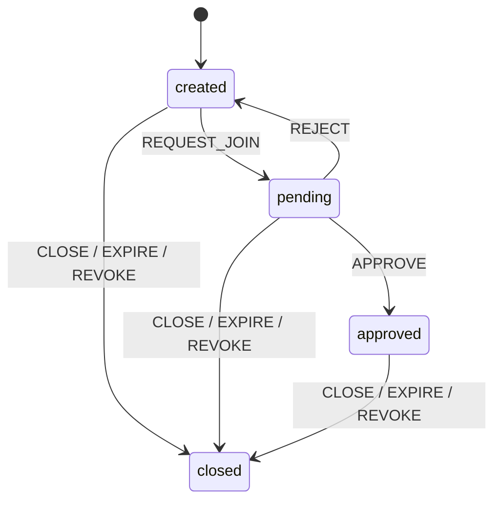
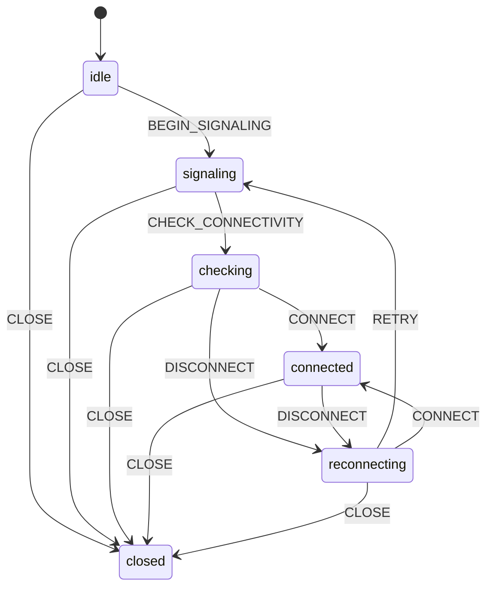
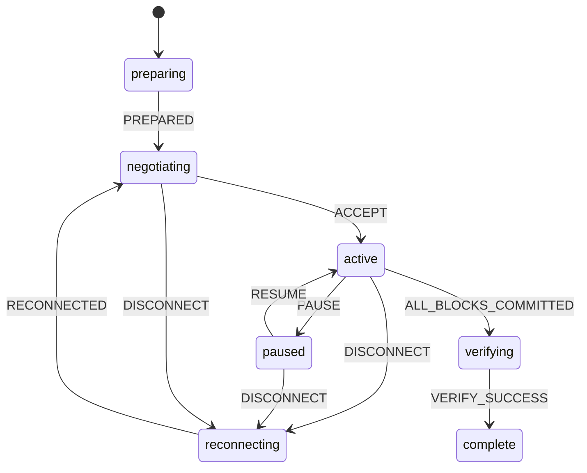

# Lifecycle contracts

Tables in `packages/protocol/src/states.ts` define every permitted transition, including explicit self-transitions. Any absent pair throws `IllegalTransitionError`. Events are discriminated unions. `pnpm test:unit` prints the allowed/rejected matrix; `pnpm demo:p0` prints all permitted edges and a synthetic walkthrough.

## Room

Repeated REQUEST_JOIN while pending, APPROVE while approved, REJECT while created, and closure while closed are self-transitions. P1 must bind repeated decisions to the same candidate/idempotency key and enforce roles and two-peer capacity. Approved rooms cannot admit another candidate.

## Peer

Closed is terminal. P2 must produce events from actual authenticated signaling/ICE. A CONNECT event alone does not prove connectivity.

## Transfer

FAIL and CANCEL are allowed from every nonterminal state. Failed, cancelled and complete are terminal; only matching repeated terminal events are accepted. Reconnection negotiates again before resuming. Verification requires exact equality of nonnegative safe-integer total and receiver-committed bytes. Completion requires `integrityVerified: true` and `storageFinalized: true`, checked at runtime. Future engines obtain evidence from real hashing/storage, not untrusted peer flags or UI input. Zero-byte files still need hash verification and finalization.

A state-only reducer cannot authorize peers, validate checkpoints, or prove integrity. P0 demonstrations use explicitly synthetic evidence and must never become production success paths.
