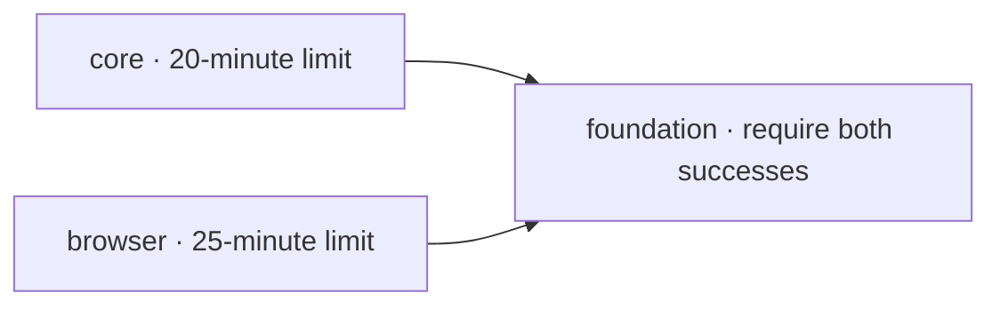

# CI timeout investigation — 4 November 2026

## Verdict and evidence

**CONFIRMED: the job exceeded its configured 20-minute execution limit.**

[Run 41870392501](https://github.com/Shreshtha280407/MeshDrop/actions/runs/41870392501)
ran commit `919995f8924f4956547e8926a6690b4de93d1c1b`, which was also the local
HEAD at the start of this task. The working tree was clean. GitHub's check
annotation explicitly states: "The job has exceeded the maximum execution time
of 20m0s". The available logs show no manual-cancellation or resource-exhaustion
signal explaining the termination.

Browser installation started at 16:45:36 UTC and ended at 16:59:21: **13m45s**.
The dominant operation was downloading **139 MB of Ubuntu packages in 13m12s**
at about **175 kB/s**. Browser-engine downloads then took approximately
15 seconds. Tests started about **15m12s into the job**, leaving less than five
minutes of its configured budget.

The browser step completed **72 of 106 tests**, all passing, before cancellation.
It continued making progress through recovery cases; no browser-test failure or
retry was recorded before the runner cancelled the job. The PWA step was skipped.
This establishes a setup/budget problem, rather than evidence of a hanging test.

The earlier successful
[run 40226538432](https://github.com/Shreshtha280407/MeshDrop/actions/runs/40226538432)
also used Ubuntu 26.04.1, but downloaded a similar **142 MB in 36 seconds**.
The immediate cause was transient package-mirror slowness. An Ubuntu-version
regression is not established by this comparison.

## Original hosted stage timings

Timings below come from the reported run's job-step timestamps, rounded to
seconds. A zero-second secret check completed within the timestamp resolution.

| Stage                                       | Duration                 | Result    |
| ------------------------------------------- | ------------------------ | --------- |
| Runner setup, checkout, pnpm and Node setup | 16s                      | Passed    |
| Frozen dependency installation              | 4s                       | Passed    |
| Package TypeScript checks                   | 12s                      | Passed    |
| Root TypeScript check                       | 4s                       | Passed    |
| Lint and formatting                         | 9s                       | Passed    |
| Secret check                                | <1s                      | Passed    |
| Release audit                               | 1s                       | Passed    |
| Security tests                              | 3s                       | Passed    |
| Unit tests                                  | 6s                       | Passed    |
| Integration tests                           | 12s                      | Passed    |
| Fault tests                                 | 4s                       | Passed    |
| Production build / Worker dry run           | 15s                      | Passed    |
| Browser engines and Linux dependencies      | 13m45s                   | Passed    |
| Browser tests                               | 5m03s before termination | Cancelled |
| Production PWA tests                        | —                        | Skipped   |

## Selected workflow architecture

The reusable workflow now has two independent validation jobs and one aggregate
gate:

- **core:** retains types, lint, secret checks, the unchanged low-threshold
  dependency audit, security/unit/integration/fault tests, and production builds.
- **browser:** performs its own frozen installation, installs all three browser
  engines and their OS dependencies, and runs the complete E2E and PWA suites.
  The 25-minute limit allows the observed 13m45s setup, approximately 7m30s for
  the normally shorter browser suite, one minute for PWA, about 30 seconds of
  checkout/package setup, and a little over two minutes of margin.
- **foundation:** preserves the original required-check name. It runs with
  `always()`, depends on both jobs, and succeeds only when both results are
  `success`. Failure, cancellation, and skipped dependencies fail this gate.
  Its two-minute limit covers only two shell assertions.

All jobs pin the already-tested OS family to `ubuntu-26.04`, a label listed in
[GitHub's runner catalog](https://github.com/actions/runner-images#available-images).
This prevents future `ubuntu-latest` migration; it is not a claim that pinning an
OS version guarantees fast mirrors. The existing Node 24, pnpm pin, frozen
lockfile, pnpm-store caching, read-only repository permissions, and triggers
are retained. The manual deployment workflow still waits for the reusable CI
workflow, including both validation jobs and the aggregate gate.

## Alternatives considered

- A project matrix would duplicate the slow setup across more runners. The
  existing suite has 54 desktop Chromium cases and 52 mobile-emulation cases;
  desktop cases include real Firefox and WebKit checks. Both projects remain
  together with two workers and the existing one CI retry. PWA retains one
  worker and no retries. No tests or timeouts in test configuration were changed.
- Browser-binary caching would target approximately 15 seconds of downloads,
  while the observed delay was in OS packages. Playwright
  [does not recommend browser caching](https://playwright.dev/docs/ci#caching-browsers)
  for this situation; Linux OS dependencies are not covered by that cache.
- A browser container or shared build artifacts add image/transfer maintenance
  without being necessary for this measured failure. The existing three-engine
  installation remains intact. Each runner needs its own package installation;
  the lightweight aggregate job has no checkout or dependency setup.

No artifacts containing raw invitations, screenshots, traces, or videos are
uploaded by the workflow.

## Workflow validation

Static syntax and expression validation used **actionlint 1.7.12**, downloaded
temporarily and checked against the official release checksum. Its bundled
runner-label catalog does not yet contain GitHub's documented `ubuntu-26.04`
label, so the local validator used a temporary catalog extension for that exact
label. No validator rule was ignored, and no self-hosted runner configuration
was added to the repository.

Additional local assertions verified that every original validation command is
retained, both jobs install with the frozen lockfile, triggers and permissions
are unchanged, and all **16** combinations of success/failure/cancellation/skip
results produce the intended aggregate result. The deployment workflow's
reusable-workflow dependency was also checked. Complete test listings before and after
the change matched exactly: 106 E2E cases and five PWA cases.

## Local validation results

Fresh validation used **Node 24.22.2**, repository-pinned **pnpm 10.34.7**, and
**CI=true**. All **642 application tests passed**, with no browser retries or
flaky results. Chromium, Firefox, WebKit, and their existing local compatibility
libraries were available. No global software or operating-system packages were
installed. The hosted cold APT/browser installation was not reproduced locally;
its duration is supported by the actual Actions logs above.

| Check                             | Exact command                    | Measured local duration | Result |
| --------------------------------- | -------------------------------- | ----------------------- | ------ |
| Frozen package installation       | `pnpm install --frozen-lockfile` | 3.8s                    | PASS   |
| Package TypeScript                | `pnpm -r typecheck`              | 6.9s                    | PASS   |
| Root TypeScript                   | `pnpm typecheck`                 | 3.2s                    | PASS   |
| Lint and formatting               | `pnpm lint`                      | 6.9s                    | PASS   |
| Secret checks                     | `pnpm check:secrets`             | 0.3s                    | PASS   |
| Dependency release audit          | `pnpm audit:release`             | 1.0s                    | PASS   |
| Unit tests: 406 passed            | `pnpm test:unit`                 | 5.0s                    | PASS   |
| Security tests: 42 passed         | `pnpm test:security`             | 2.0s                    | PASS   |
| Integration tests: 65 passed      | `pnpm test:integration`          | 8.6s                    | PASS   |
| Fault tests: 18 passed            | `pnpm test:faults`               | 3.4s                    | PASS   |
| Production build / Worker dry run | `pnpm build`                     | 10.9s                   | PASS   |
| Browser tests: 106 passed         | `pnpm test:e2e`                  | 5m47s                   | PASS   |
| Production PWA: 5 passed          | `pnpm test:pwa`                  | 22.0s                   | PASS   |

The workflow validator and aggregate-result contract checks passed separately.
The final checks also preserved all original test listings and every tracked
file hash other than `.github/workflows/ci.yml`. This includes the minimatch
11.0.1 override and lockfile, production code, test configuration, README, and
all README media. Only the workflow and this investigation report changed.

## Remaining limits and repository safety

These are local results. The revised workflow has **not** been executed on a
GitHub-hosted runner, and local timings do not establish future APT throughput.
Package-mirror latency remains variable; a sufficiently long external stall can
still exhaust a finite job budget. The split avoids charging core validation
against browser setup, and the measured budget covers the observed slow setup
plus the normal full browser/PWA workload. A persistently slower hosted setup
would justify a new measured investigation, including the browser-container
option, rather than silently enlarging limits.

No test was skipped, removed, disabled, or weakened. Existing per-test limits,
CI retries, worker counts, security threshold, and release gates are intact.
The separate legacy local-rollback limitation recorded in Task 01 was not
modified or reclassified by this task.

Git commits created: **0**. Pushes: **0**. Pull requests: **0**. Deployments: **0**.
No GitHub settings, secrets, remote infrastructure, or production behavior was
changed. All changes remain local and uncommitted. No next improvement phase
was started.
